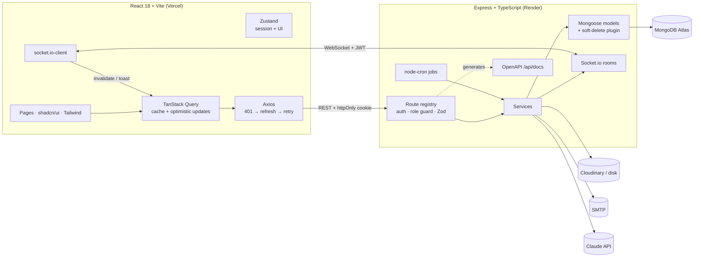
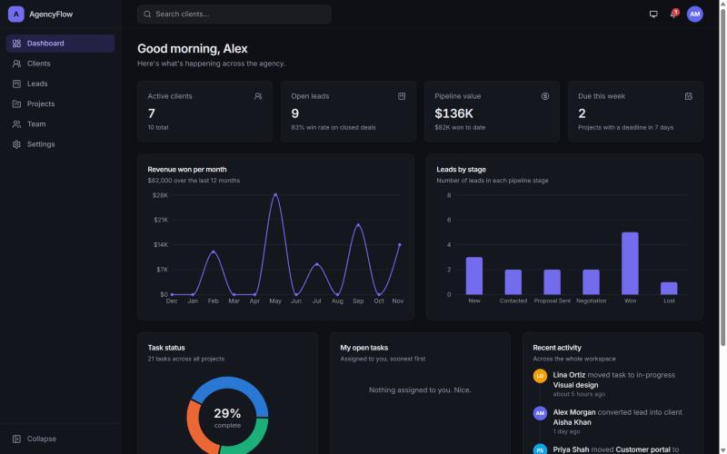
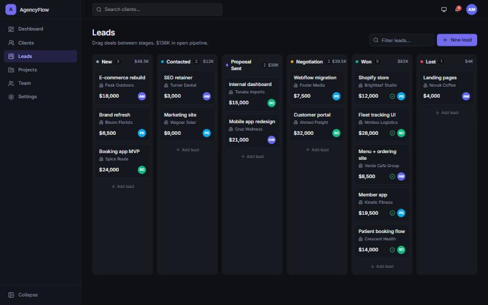
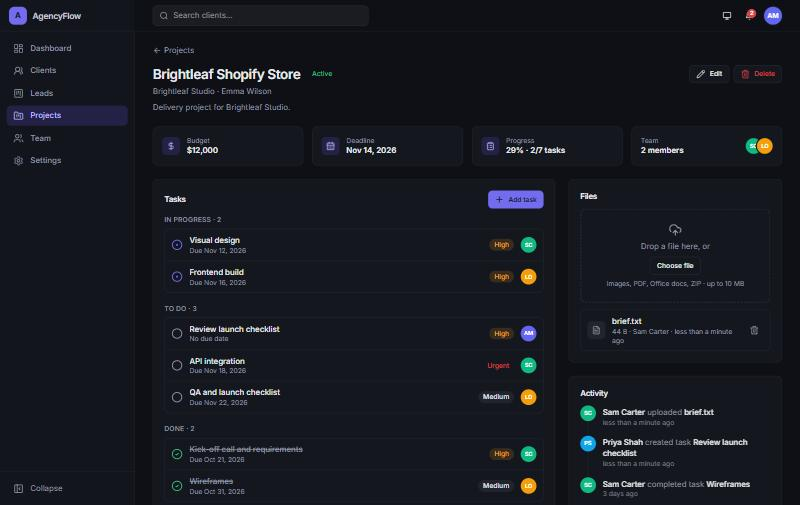
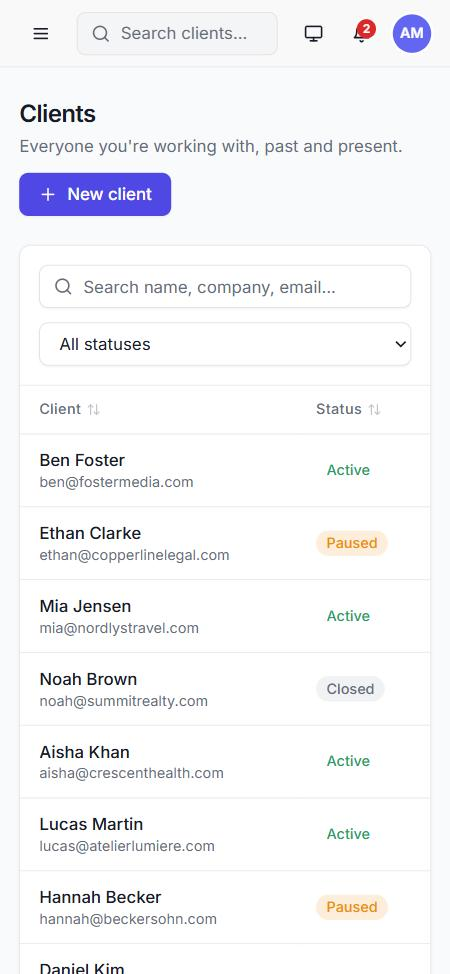

# AgencyFlow

**A mini operating system for small digital agencies.** Find work (sales pipeline), win it (auto-convert to clients), deliver it (projects, task boards, time tracking, files), bill it (invoices with PDFs) and keep clients in the loop (client portal). Built with MERN + TypeScript.

[](https://github.com/shoaib1920/agencyflow/actions/workflows/ci.yml)   

**Live demo:** https://agencyflow-neon.vercel.app (the free API host sleeps when idle; the first load can take ~30 s)
**API docs:** https://agencyflow-api-c2kp.onrender.com/api/docs

| Demo login | Email | Password |
|---|---|---|
| Admin | `admin@agencyflow.dev` | `Admin@123` |
| Manager | `manager@agencyflow.dev` | `Manager@123` |
| Member | `sam@agencyflow.dev` | `Member@123` |
| Client portal | `client@agencyflow.dev` | `Client@123` |

---

## Features

### Sell
- **Leads Kanban**: six stages, drag and drop with `@dnd-kit` (mouse, touch, keyboard), optimistic updates with rollback, fractional positions (one write per drop).
- **Won → Client** automatically (idempotent), then **"Invoice this deal"** in one click.
- **AI lead assist (Claude)**: summarize a lead, draft a follow-up email, or suggest next steps. The key stays on the server, the lead is sent as data, and use is rate-limited per user.
- **CSV import/export** for clients and leads, with a preview, per-row validation errors and spreadsheet formula-injection protection.

### Deliver
- **Projects** with budget, deadline, estimated hours and a team. Members only see the projects they're on.
- **Tasks as a list or a Kanban board** (drag between To do / In progress / Done).
- **Time tracking**: start/stop timers (one running timer per person, shown in the top bar), manual entries, hours per person and per task, and logged vs estimated hours.
- **Discussion with @mentions** on projects and tasks; internal notes are hidden from clients.
- **Files**: drag-and-drop uploads to Cloudinary, or local disk when no keys are set.

### Bill
- **Invoices**: line items, tax, discount and currency. Totals are always recomputed on the server; numbers are sequential (`INV-2026-0001`).
- Workflow **draft → sent → paid** (or void). **Overdue** is derived from the due date, never stored.
- **PDF invoices** (pdfkit): view, download, or email them to the client as an attachment.
- **Money dashboard**: collected, outstanding and overdue, computed with one `$facet` aggregation.

### Collaborate
- **Client portal**: a fourth role. Clients see their projects' progress, milestones and files, download their invoices and message the team. Budgets, drafts and internal notes never leave the server.
- **Email invites**: single-use links (only a SHA-256 hash is stored), 7-day expiry. Shown to the inviter too, so they work without email configured.
- **Real-time notifications** (Socket.io rooms per user) for assignments, mentions, client messages, deal moves and invoices, plus optional **email notifications** (per-user setting).
- **Due-date reminders**: an hourly background job sends one reminder per task per day.

### Operate
- **Ctrl+K command palette**: global search across clients, leads, projects, tasks and invoices, scoped to what you're allowed to see.
- **Trash with 30-day restore**: a soft-delete Mongoose plugin hides deleted documents from every query and aggregation. A project restores together with exactly the tasks deleted with it. Old items are purged automatically.
- **Dashboard**: KPIs, revenue per month, leads by stage and task status, all from MongoDB aggregation pipelines.
- **Activity log**, dark/light/system theme, responsive layout, skeletons, empty states and error boundaries.

## Roles

| Action | Admin | Manager | Member | Client (portal) |
|---|---|---|---|---|
| Dashboard, clients, leads | ✓ | ✓ | ✓ | - |
| Create/edit clients, import/export CSV | ✓ | ✓ | - | - |
| Delete clients, purge trash, manage team | ✓ | - | - | - |
| Projects | all | all | assigned only | own company (read-only) |
| Tasks, comments, time | ✓ | ✓ | on their projects | comment only |
| Invoices | ✓ | ✓ | - | own sent/paid + PDF |
| Invite portal users, restore from trash | ✓ | ✓ | - | - |

Every rule is enforced on the server (route role guards plus row-level scoping in services); the UI only hides what you can't use.

## Architecture



The routes are declared once in a **route registry** (`server/src/routes/registry.ts`). Each declaration wires authentication, the role guard and Zod validation, and also records the route's metadata. The Swagger/OpenAPI document at `/api/docs` is generated from that registry and the same Zod schemas, so the API docs can't drift from the code.

```
agencyflow/
├── server/src
│   ├── config/      env (Zod-validated), db, pino logger
│   ├── routes/      registry + all endpoints (permission matrix at the top)
│   ├── controllers/ HTTP in/out only
│   ├── services/    business rules: invoices, portal, invites, comments, time, search, csv, trash, ai…
│   ├── models/      Mongoose schemas (+ softDelete plugin)
│   ├── jobs/        cron: due-date reminders, trash purge
│   ├── docs/        OpenAPI generator
│   └── scripts/     seed
├── server/tests     Jest + Supertest (in-memory MongoDB)
├── client/src
│   ├── pages/       routes (lazy-loaded), incl. portal/
│   ├── features/    invoices, leads, projects, comments, csv, team…
│   ├── components/  ui/ (shadcn-style), layout/ (sidebar, top bar, palette, portal shell)
│   ├── hooks/       useSocket, useTimer, useDebounce
│   └── test/        Vitest + Testing Library
├── docker-compose.yml · render.yaml · client/vercel.json · .github/workflows/ci.yml
```

## Key engineering decisions

| Decision | Why |
|---|---|
| Access token in memory + rotating refresh token in an httpOnly cookie | XSS can't steal the long-lived credential. Reusing an old refresh token revokes the whole session family. |
| Single-flight refresh + one retry on network/5xx | Concurrent 401s share one refresh, and a sleeping free-tier server doesn't log people out. |
| Optimistic Kanban (leads and tasks) with fractional positions | Instant UI, one database write per drop, rollback on failure. |
| Totals, numbering and "overdue" computed on the server | The browser can't tamper with money; status can't go stale. |
| Soft-delete plugin on query + aggregate hooks | Every existing query hides trashed data without changing any service code. |
| Portal scope taken from the signed token | A client can't widen their access by changing a request parameter. |
| Invite tokens stored as SHA-256 hashes | A database leak can't be used to accept invites. |
| CSV cells starting with `= + - @` are prefixed with an apostrophe | Prevents spreadsheet formula injection in exports. |
| Route registry generating OpenAPI | Validation, permissions and docs come from one source of truth. |
| Claude call: lead passed as tagged data, low effort, server-side fallbacks, 30 calls/hour per user | Cheap, predictable, injection-aware and abuse-resistant. |

## Getting started

**Prerequisites:** Node 20+, and MongoDB (local `mongod`, Docker, or a free Atlas cluster).

```bash
npm run install:all                 # root + server + client
cp server/.env.example server/.env  # edit MONGO_URI / secrets if needed
npm run seed                        # demo data (wipes the agencyflow database)
npm run dev                         # API on :5000, web on :5173, API docs on :5000/api/docs
```

### With Docker (no local Node or MongoDB needed)

```bash
docker compose up --build
docker compose exec api npm run seed:prod
```

Then open http://localhost:8080. Nginx serves the app and proxies `/api`, `/uploads` and `/socket.io` to the API container.

### Scripts

| Command | What it does |
|---|---|
| `npm run dev` | API (tsx watch) + web (Vite) |
| `npm run seed` | Reset and seed demo data (users, clients, leads, projects, tasks, time, comments, invoices, portal user) |
| `npm test` | 33 API tests (Jest + Supertest, in-memory MongoDB) + 11 web tests (Vitest + Testing Library) |
| `npm run lint` · `npm run format` | ESLint · Prettier |
| `npm run build` | Compile API + build web |

## Environment variables

**`server/.env`**

| Variable | Default | Notes |
|---|---|---|
| `NODE_ENV` | `development` | `production` enables secure cross-site cookies |
| `PORT` / `API_PORT` | `5000` | `API_PORT` wins if both are set |
| `CLIENT_URL` | `http://localhost:5173` | Allowed CORS origin(s), comma-separated. The first one is used in email links |
| `MONGO_URI` | `mongodb://127.0.0.1:27017/agencyflow` | Include the database name (`/agencyflow`) |
| `JWT_ACCESS_SECRET`, `JWT_REFRESH_SECRET` | dev values | **Long random values in production** |
| `ACCESS_TOKEN_TTL`, `REFRESH_TOKEN_TTL_DAYS` | `15m`, `7` | |
| `CLOUDINARY_CLOUD_NAME` / `_API_KEY` / `_API_SECRET` | empty | Optional. Without them files go to `server/uploads` (ephemeral on Render) |
| `SMTP_HOST`, `SMTP_PORT`, `SMTP_USER`, `SMTP_PASS`, `MAIL_FROM` | empty / `587` | Optional (Resend, Brevo, Mailtrap, Gmail app password…). Without them emails are logged, not sent |
| `ANTHROPIC_API_KEY` | empty | Optional. Enables AI lead assist |
| `CRON_ENABLED` | `true` | Background reminders and trash purge |
| `COOKIE_SECURE` | production only | Set `false` to run production mode over plain http (Docker) |
| `LOG_LEVEL` | `info` | pino log level |

**`client/.env`**: `VITE_API_URL` is empty in dev (Vite proxies to the API); set it to the API origin in production.

## API

Interactive docs: **`/api/docs`** (Swagger UI, generated from the code). Every response uses `{ success, data, message, meta }`.

| Area | Endpoints |
|---|---|
| Auth | `POST /auth/register · login · refresh · logout`, `GET/PATCH /auth/me`, `PATCH /auth/me/password`, `GET /auth/invite`, `POST /auth/accept-invite` |
| Team & invites | `GET/POST /users`, `PATCH /users/:id`, `GET/POST /invites`, `DELETE /invites/:id` |
| Clients | `GET/POST /clients`, `GET/PATCH/DELETE /clients/:id`, `GET /clients/export`, `POST /clients/import` |
| Leads | `GET/POST /leads`, `GET/PATCH/DELETE /leads/:id`, `PATCH /leads/:id/stage`, `POST /leads/:id/ai`, `GET /leads/export`, `POST /leads/import` |
| Projects | `GET/POST /projects`, `GET/PATCH/DELETE /projects/:id`, `GET /projects/:id/activity`, `POST/DELETE /projects/:id/files[/:fileId]` |
| Tasks | `GET/POST /projects/:id/tasks`, `PATCH/DELETE /projects/:id/tasks/:taskId` |
| Comments | `GET/POST /projects/:id/comments`, `GET /projects/:id/comment-counts`, `DELETE /comments/:id` |
| Time | `GET/POST /projects/:id/time`, `POST /projects/:id/timer/start`, `GET /time/running`, `POST /time/stop`, `DELETE /time/:id` |
| Invoices | `GET/POST /invoices`, `POST /invoices/from-lead/:leadId`, `GET/PATCH/DELETE /invoices/:id`, `GET /invoices/:id/pdf`, `POST /invoices/:id/status` |
| Portal | `GET /portal`, `GET /portal/projects/:id` |
| Workspace | `GET /dashboard`, `GET /activity`, `GET /search`, `GET/PATCH /notifications…`, `GET /trash`, `POST /trash/:type/:id/restore`, `DELETE /trash/:type/:id`, `GET /ai/status`, `POST /jobs/:name` |

Socket.io (connect with `auth: { token }`): `notification:new` to `user:<id>`; `leads:changed` broadcast.

## Testing

- **API (33 tests):** auth and refresh-token reuse detection, role guards, client CRUD and pagination, lead moves and Won → Client, invoice math, numbering, workflow, PDF output and overdue, invites (hashed and single-use), portal isolation (403 on every internal route, no drafts or internal notes), trash restore/purge, mentions, timers, search scoping, CSV import and formula escaping.
- **Web (11 tests):** Kanban position math, invoice preview totals (same rounding as the server), the error parser, and component tests for the login form and status badges.
- **CI:** GitHub Actions runs lint, typecheck, tests and build for both apps on every push.

## Deployment

| Part | Where | Notes |
|---|---|---|
| Web | Vercel | Root `client`, `VITE_API_URL` = API origin, SPA rewrites in `vercel.json` |
| API | Render (Singapore) | `render.yaml`. Set `MONGO_URI`, `CLIENT_URL`, and optionally SMTP, Anthropic and Cloudinary keys |
| Database | MongoDB Atlas (Mumbai) | Network access `0.0.0.0/0` (Render has no static IP). Seed once from a local machine |

Cross-domain auth works because the refresh cookie is `SameSite=None; Secure; HttpOnly` in production, CORS allows only `CLIENT_URL`, and Express trusts Render's proxy.

## Screenshots

| Dashboard | Leads Kanban |
|---|---|
|  |  |
| **Project detail** | **Clients (mobile, light)** |
|  |  |
