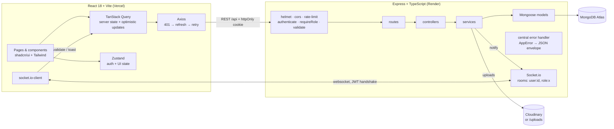

# AgencyFlow

**Client, lead and project management for small digital agencies.** A full-stack MERN + TypeScript app: drag deals through a sales pipeline, auto-convert wins into clients, run delivery projects with tasks and files, and get live notifications when work lands on your plate.

  

---

## Features

| Area | What it does |
|---|---|
| **Auth & roles** | Register / login / logout, short-lived JWT access token + httpOnly refresh cookie with **rotation and reuse detection**. Roles `admin`, `manager`, `member` enforced in API middleware *and* reflected in the UI. First account becomes admin. |
| **Team** (admin) | Add members with a temporary password, change roles, deactivate (revokes their sessions). Guards against removing the last admin or demoting yourself. |
| **Clients** | CRUD with server-side search, status filter, sortable columns and pagination. Filters live in the URL. Detail drawer shows contact info, notes and the client's projects. |
| **Leads Kanban** | Six stages (New → Contacted → Proposal Sent → Negotiation → Won / Lost). Drag and drop with `@dnd-kit` (mouse, touch and keyboard), **optimistic updates** with rollback. Dropping in **Won** creates a Client automatically (idempotent). |
| **Projects & tasks** | Projects belong to a client with budget, deadline, status and members. Tasks with assignee, priority, due date and one-click status cycling. Members only see projects they're on. |
| **Files** | Drag-and-drop uploads via Multer → **Cloudinary**, or the local `/uploads` folder when no Cloudinary keys are set. Type and size validated. |
| **Real-time** | Socket.io pushes a notification when a task is assigned to you or a lead changes stage. Bell with unread count and dropdown; notifications are persisted in MongoDB. The Kanban refreshes live when teammates move cards. |
| **Dashboard** | KPI cards (active clients, open leads, pipeline value, projects due this week) and charts (leads by stage, revenue won per month, task status) all computed with **MongoDB aggregation pipelines**. |
| **Activity log** | Who did what (created client, moved lead, completed task, uploaded file…) on the dashboard and per project. |
| **UX** | Collapsible sidebar (sheet on mobile), dark / light / system theme, skeleton loaders, empty states, error boundaries, toasts, fully responsive. |

## Screenshots

> Captured from the seeded demo. Replace with higher-resolution shots in `docs/screenshots/` if you like.

| Dashboard | Leads Kanban |
|---|---|
|  |  |
| **Project detail** | **Clients (mobile, light)** |
|  |  |

## Architecture



```
agencyflow/
├── package.json          # concurrently: `npm run dev` starts both apps
├── render.yaml           # API deploy blueprint
├── server/
│   ├── src/
│   │   ├── config/       # env (Zod-validated), db
│   │   ├── middleware/   # auth, requireRole, validate, upload, errorHandler
│   │   ├── models/       # User, RefreshToken, Client, Lead, Project, Task, Notification, Activity
│   │   ├── schemas/      # Zod request schemas
│   │   ├── services/     # business logic (no Express types)
│   │   ├── controllers/  # HTTP in/out only
│   │   ├── routes/       # routing + permission matrix
│   │   ├── socket/       # Socket.io server, auth, rooms
│   │   ├── scripts/seed.ts
│   │   └── utils/        # AppError, tokens, pagination, response envelope
│   └── tests/            # Jest + Supertest (in-memory MongoDB)
└── client/
    ├── vercel.json       # SPA rewrites
    └── src/
        ├── components/   # ui/ (shadcn-style), layout/, shared/
        ├── features/     # clients, leads, projects (dialogs, cards, panels)
        ├── pages/        # route components (lazy-loaded)
        ├── hooks/        # useSocket, useDebounce
        ├── stores/       # Zustand: auth, ui
        └── lib/          # axios instance, query client & keys, types, utils
```

## Tech decisions

| Choice | Why |
|---|---|
| **Layered API** (`routes → controllers → services → models`) | Controllers only translate HTTP; services hold the rules (RBAC scoping, conversion, notifications) and are reusable from sockets, seeds and tests. |
| **Access token in memory + refresh token in httpOnly cookie** | XSS can't read the long-lived credential; the 15-minute access token limits damage if one leaks. Rotation + reuse detection turns a stolen refresh token into a forced logout. |
| **TanStack Query for server state, Zustand for client state** | Caching, background refetch, invalidation and optimistic updates come for free; Zustand stays tiny (session + theme/sidebar). |
| **Fractional positions for Kanban order** | A drop writes one document (midpoint between neighbours) instead of re-indexing a whole column. |
| **Aggregation pipelines for stats** | `$group`/`$facet`-style work runs inside MongoDB next to the indexes; the API ships a few rows instead of every document. |
| **Zod on both sides** | One validation library for env, request bodies/queries and forms; parsed values replace raw input so controllers receive typed, coerced data. |
| **Consistent envelope** `{ success, data, message, meta }` | The frontend has one error parser and one pagination shape. |
| **Cloudinary with local fallback** | Works with zero config locally and with durable storage in production (Render disks are ephemeral). |
| **Socket rooms per user** | `io.to('user:<id>')` reaches every tab/device of one person without tracking socket IDs. |

## Getting started

**Prerequisites:** Node 20+, and MongoDB (local `mongod` or a free MongoDB Atlas cluster).

```bash
git clone <your-repo-url> agencyflow && cd agencyflow
npm run install:all                 # root + server + client
cp server/.env.example server/.env  # then edit MONGO_URI / secrets if needed
npm run seed                        # demo data (wipes the agencyflow DB)
npm run dev                         # API on :5000, web on :5173
```

Open http://localhost:5173 and use a demo account (the login page has one-click buttons).

### Seed credentials

| Role | Email | Password |
|---|---|---|
| Admin | `admin@agencyflow.dev` | `Admin@123` |
| Manager | `manager@agencyflow.dev` | `Manager@123` |
| Member | `sam@agencyflow.dev` | `Member@123` |
| Member | `lina@agencyflow.dev` | `Member@123` |

The seed creates 4 users, 10 clients, 15 leads across every stage (won deals spread over the last year for the revenue chart), 4 projects with 21 tasks, activity and notifications.

### Scripts

| Command | What it does |
|---|---|
| `npm run dev` | API (tsx watch) + client (Vite) together |
| `npm run seed` | Reset and seed the database |
| `npm test` | Jest + Supertest API tests (uses an in-memory MongoDB; set `MONGO_URI_TEST` to use a real one) |
| `npm run lint` | ESLint on server and client |
| `npm run format` | Prettier |
| `npm run build` | Compile the API and build the client |

## Environment variables

**`server/.env`**

| Variable | Default | Notes |
|---|---|---|
| `NODE_ENV` | `development` | `production` enables secure cross-site cookies |
| `PORT` / `API_PORT` | `5000` | `API_PORT` wins if both are set |
| `CLIENT_URL` | `http://localhost:5173` | Allowed CORS origin(s), comma-separated |
| `MONGO_URI` | `mongodb://127.0.0.1:27017/agencyflow` | Atlas connection string in production |
| `JWT_ACCESS_SECRET` | dev value | **Set a long random value in production** |
| `JWT_REFRESH_SECRET` | dev value | **Set a long random value in production** |
| `ACCESS_TOKEN_TTL` | `15m` | |
| `REFRESH_TOKEN_TTL_DAYS` | `7` | |
| `CLOUDINARY_CLOUD_NAME` / `_API_KEY` / `_API_SECRET` | empty | Optional; without them files go to `server/uploads` |

**`client/.env`**

| Variable | Notes |
|---|---|
| `VITE_API_URL` | Empty in dev (Vite proxies `/api`, `/uploads`, `/socket.io`). Set to the API origin in production. |

## API

All responses use `{ success, data, message, meta }`. Lists return `meta: { page, limit, total, totalPages }`. Authenticated routes need `Authorization: Bearer <accessToken>`.

| Method | Endpoint | Access | Description |
|---|---|---|---|
| GET | `/api/health` | public | Health + DB status |
| POST | `/api/auth/register` | public | Create account (first user → admin) |
| POST | `/api/auth/login` | public | Returns access token, sets refresh cookie |
| POST | `/api/auth/refresh` | cookie | Rotate refresh token, new access token |
| POST | `/api/auth/logout` | cookie | Revoke the session family |
| GET / PATCH | `/api/auth/me` | auth | Current user / update profile |
| PATCH | `/api/auth/me/password` | auth | Change password (revokes other sessions) |
| GET | `/api/users` | auth | Team list (`?all=true` for admins includes inactive) |
| POST | `/api/users` | admin | Add team member |
| PATCH | `/api/users/:id` | admin | Change role / activate / deactivate |
| GET | `/api/clients` | auth | `?page&limit&search&status&sort&order` |
| GET | `/api/clients/:id` | auth | Client + its projects |
| POST | `/api/clients` | admin, manager | Create |
| PATCH | `/api/clients/:id` | admin, manager | Update |
| DELETE | `/api/clients/:id` | admin | Delete (blocked if it has projects) |
| GET | `/api/leads` | auth | All leads for the board |
| POST | `/api/leads` | auth | Create |
| PATCH | `/api/leads/:id` | auth | Update |
| PATCH | `/api/leads/:id/stage` | auth | `{ stage, position }`: move; Won → creates client |
| DELETE | `/api/leads/:id` | admin, manager | Delete |
| GET | `/api/projects` | auth | Paginated; members see only their projects |
| GET | `/api/projects/:id` | project access | Project with members & files |
| POST | `/api/projects` | admin, manager | Create |
| PATCH / DELETE | `/api/projects/:id` | admin, manager | Update / delete (cascades tasks, files, activity) |
| GET | `/api/projects/:id/activity` | project access | Project timeline |
| POST | `/api/projects/:id/files` | project access | Multipart upload, field `file`, ≤ 10 MB |
| DELETE | `/api/projects/:id/files/:fileId` | project access | Remove file |
| GET / POST | `/api/projects/:projectId/tasks` | project access | List / create tasks |
| PATCH | `/api/projects/:projectId/tasks/:taskId` | project access | Update (assigning notifies) |
| DELETE | `/api/projects/:projectId/tasks/:taskId` | admin, manager | Delete |
| GET | `/api/dashboard` | auth | KPIs, chart data, activity, my tasks |
| GET | `/api/activity` | auth | Workspace activity feed |
| GET | `/api/notifications` | auth | Latest 20 + `meta.unread` |
| PATCH | `/api/notifications/:id/read` · `/read-all` | auth | Mark read |

**Socket.io events** (connect with `auth: { token: accessToken }`): `notification:new` (to `user:<id>`), `leads:changed` (broadcast).

## Testing

```bash
npm test
```

17 Jest + Supertest tests against an in-memory MongoDB:

- **Auth**: first user is admin, duplicate email, validation errors, login success/failure, `/me`, refresh rotation and **reuse detection revoking the whole token family**.
- **Role guard**: member can't create clients, manager can't delete them, only admins manage the team, tampered tokens rejected.
- **Clients CRUD**: create/read/update/delete, validation, server-side pagination, search, filter and sort, malformed IDs.
- **Lead stage change**: move + position, activity logged, managers notified, Won converts to exactly one client, invalid stage rejected.

## Deployment

1. **Database**: create a free MongoDB Atlas cluster, allow Render's egress (or `0.0.0.0/0` for a demo), copy the connection string.
2. **API on Render**: New → Blueprint → pick this repo (`render.yaml`). Set `MONGO_URI`, `CLIENT_URL` (your Vercel URL) and optionally the Cloudinary keys. JWT secrets are generated. Run the seed once from the Render shell: `npm run seed` (requires dev deps, which the build installs).
3. **Web on Vercel**: import the repo with **Root Directory = `client`**, set `VITE_API_URL` to the Render URL. `vercel.json` rewrites all routes to `index.html`.

Cross-domain auth works because in production the refresh cookie is `SameSite=None; Secure; HttpOnly`, CORS allows only `CLIENT_URL` with credentials, and Express trusts the proxy so `secure` cookies are set behind Render's TLS terminator.

## Roadmap ideas

Email invites with magic links · invoice generation from won deals · per-client portal · Kanban for tasks · Redis adapter for multi-instance Socket.io.
